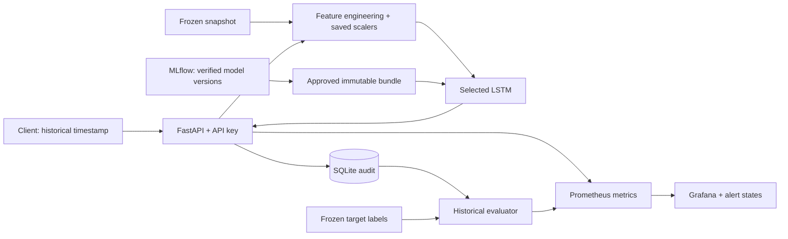

# Market Forecast MLOps

[](https://github.com/sina-04/Market-Forecast-MLOps/actions/workflows/tests.yml)
[](https://www.python.org/)
[](LICENSE)

Versioned LSTM inference with a FastAPI service, Docker deployment, and model monitoring. This repository continues the [Market Forecast research project](https://github.com/sina-04/Market-Forecast) and packages its validation-selected hourly model into a reproducible service.

**The current release serves historical replay.** Clients select a timestamp from a frozen dataset; the API reconstructs the input window and predicts the next observed traded bar. The data uses retrospective corporate-action adjustments. Live market ingestion and point-in-time forecasting are outside this release.

## What the project includes

- A selected Keras model, its training-fitted scalers, ordered feature contract, and verified source snapshot.
- Content-derived release fingerprints, checksummed bundles, and an MLflow model registry with explicit promotion and rollback.
- An authenticated FastAPI prediction endpoint with input validation, health checks, OpenAPI documentation, and durable SQLite audit records.
- A Docker Compose stack for the API, MLflow, Prometheus, and Grafana. The serving container runs without root and does not require a GPU.
- Historical error metrics and feature PSI, provisioned dashboards, and tested alert rules.
- Automated numerical parity checks, a paced HTTP load test, and backup, restore, and rollback rehearsals.

The repository contains the model and data needed to build and verify the service. It does not require downloading a model from Google Drive or running a training notebook first.

## Architecture



The API loads its verified bundle at startup and keeps the model resident. It can continue serving while MLflow is unavailable. Registry aliases organize releases; changing an alias does not replace a running container.

## Model and data contract

| Property | Value |
| --- | --- |
| Asset | Foolad, Mobarakeh Steel Company, Iranian equity market |
| Model | Full-feature LSTM selected using validation data |
| Architecture | 60 observed input bars, 49 features, 32 LSTM units |
| Training target | Next observed bar's log return |
| API output | Reconstructed adjusted last traded price, in retrospectively adjusted rials |
| Frozen source coverage | 4,273 bars, October 2, 2021 through September 30, 2026 |
| Training / validation / test targets | 2,490 / 533 / 535 |
| API replay windows | The 535 verified held-out test windows |
| Time interpretation | Exchange-local `Asia/Tehran`; bar timestamps label their start |

The service rebuilds features from the original initialization history, preserves feature order, and uses the saved scalers. Indicators restart after known unresolved dates, and windows crossing those gaps are excluded. Normal overnight, holiday, and weekend gaps remain observed-bar gaps. The next target is not necessarily one clock hour after the final input bar.

The [model provenance guide](results/foolad-hourly-a100/README.md) explains the selected artifact subset and checksum manifests. The [hourly methodology](docs/hourly_experiment.md) covers adjustment, features, and chronological evaluation.

### Original held-out results

These are research results from the frozen experiment, not new measurements produced by deploying the API.

| Model | MAE, adjusted rials | RMSE, adjusted rials | MAPE, % |
| --- | ---: | ---: | ---: |
| Selected full-feature LSTM | 22.646 | 33.049 | 0.935 |
| Persistence | **20.322** | 32.793 | **0.832** |
| Ridge | 52.373 | 99.132 | 2.149 |
| OHLCV comparison LSTM | 22.452 | **32.143** | 0.923 |

The selected LSTM did not beat persistence on test RMSE. The OHLCV model's lower test RMSE did not replace the model selected on validation data. This repository preserves that decision and does not claim trading profitability. Comparison weights and candidate-search artifacts remain in the upstream research repository.

## Quick start

### Prerequisites

- Docker Desktop with Linux containers on Windows, or Docker Engine on Linux amd64.
- Docker Compose **2.24.4 or newer** for the recovery override syntax.
- Host Python **3.10 or newer** for management scripts, which use only the standard library. Scientific dependencies run inside Docker.
- A working internet connection for the first image and dependency downloads.

The container runtime is pinned to Python 3.12, TensorFlow CPU 2.19.1, and Keras 3.13.2. The API is limited to two CPUs and 2 GiB RAM; MLflow and monitoring run in separate containers. Allow memory and disk space for the full stack and initial image builds.

Commands below use `python`, as on Windows. Use `python3` on Linux if that is your interpreter command.

```powershell
git clone https://github.com/sina-04/Market-Forecast-MLOps.git
cd Market-Forecast-MLOps
python deploy/setup.py
docker build --target production -t marketforecast-service:local .
python deploy/pin_release.py
docker compose up -d --no-build --wait mlflow
docker compose run --rm register
docker compose up -d --no-build --wait api prometheus grafana
docker compose ps
```

The image build verifies the selected source artifacts and reproduces all 535 saved predictions. Registration logs the complete predictor to MLflow, reloads it, checks prediction parity, and promotes the verified version. Repeating registration reuses the same release fingerprint.

`setup.py` generates a random API key and Grafana administrator password in the ignored `.env` file. It preserves an existing file and does not print the credentials. `pin_release.py` records the fingerprint tag and Docker image ID in `deploy/local/deployment.json`.

| Interface | Local address |
| --- | --- |
| Interactive API documentation | [localhost:8000/docs](http://127.0.0.1:8000/docs) |
| MLflow | [localhost:5000](http://127.0.0.1:5000) |
| Prometheus | [localhost:9090](http://127.0.0.1:9090) |
| Grafana dashboard | [localhost:3000/d/forecast-replay](http://127.0.0.1:3000/d/forecast-replay) |

Grafana's username is `admin`; its password is `GRAFANA_ADMIN_PASSWORD` in `.env`. All published ports bind to `127.0.0.1`. Keep local credentials out of Git.

To stop the stack while retaining its persistent data:

```powershell
docker compose down
```

## API usage

| Endpoint | Authentication | Purpose |
| --- | --- | --- |
| `GET /health/live` | None | Process liveness |
| `GET /health/ready` | None | Model initialization and writable audit storage |
| `GET /v1/model` | `X-API-Key` | Model contract, release identity, coverage, and limitations |
| `GET /v1/replay/timestamps` | `X-API-Key` | Eligible input and target timestamp pairs |
| `POST /v1/predict` | `X-API-Key` | Forecast for one eligible historical timestamp |
| `GET /metrics` | Internal/local | Prometheus collection |

PowerShell example:

```powershell
$forecastKey = ((Get-Content .env | Where-Object { $_ -like 'MARKETFORECAST_API_KEY=*' }) -split '=', 2)[1]
$headers = @{ 'X-API-Key' = $forecastKey }
$times = Invoke-RestMethod http://127.0.0.1:8000/v1/replay/timestamps -Headers $headers
$body = @{ as_of = $times.timestamps[0].as_of } | ConvertTo-Json
Invoke-RestMethod http://127.0.0.1:8000/v1/predict -Method Post -Headers $headers -ContentType 'application/json' -Body $body
```

With `MARKETFORECAST_API_KEY` set securely in a Bash shell:

```bash
curl -X POST http://127.0.0.1:8000/v1/predict \
  -H "X-API-Key: $MARKETFORECAST_API_KEY" \
  -H 'Content-Type: application/json' \
  -d '{"as_of":"2025-05-03T12:00:00+03:30"}'
```

The response includes prediction ID, release fingerprint, registry version, input timestamp, target timestamp, predicted adjusted price, persistence forecast, units, and `mode: "historical_replay"`. Actual target prices are not returned or used as prediction inputs.

`as_of` must include a timezone offset and identify an exact supported input-bar label. Malformed requests receive `422`, unsupported timestamps `404`, and invalid or missing credentials `401`. Inference or durable audit failures cannot return a successful forecast.

## Verification

```powershell
docker build --target test -t marketforecast-test:local .
docker run --rm -e MARKETFORECAST_TRAIN_TEST=1 marketforecast-test:local pytest -q
docker compose exec -T api marketforecast-service verify
docker compose exec -T -w /etc/prometheus prometheus promtool test rules alerts.test.yml
python tools/production_acceptance.py
python tools/production_operations_check.py
```

The acceptance script verifies all 535 HTTP forecasts, warms the API, and sends 300 requests at five requests per second over 60 seconds, with at most five concurrent workers. Passing requires zero unexpected errors, p95 latency below 500 ms, and peak API container memory below 2 GiB.

The original laptop validation measured **94.44 ms p95 latency** and **577.7 MiB peak API container memory**, with no unexpected errors. These are measurements for that run, not guarantees for another machine. [Recorded evidence](docs/validation/acceptance.json) includes its exact release identity and test settings. Publishing this focused artifact subset changes the package fingerprint; a fresh build verifies its own identity and numerical parity.

Parity uses the original tolerance: `abs(prediction - saved) <= 0.001 + 1e-6 * abs(saved)`. Tests also cover feature causality, gaps, timezone equivalence, corruption, failed audit writes, invalid outputs, deduplication, backup integrity, and restore refusal for nonempty destinations. Synthetic fixtures test software behavior and do not establish market performance.

GitHub Actions runs the lightweight research regression tests and a container job that checks the real model, Compose deployment, alert rules, HTTP acceptance, and isolated recovery. Run the operational checks separately from load testing: they deliberately restart services and stop MLflow temporarily.

## Monitoring and maintenance

Prometheus scrapes every 15 seconds. The evaluator updates historical diagnostics every 60 seconds using the latest 100 distinct recorded target timestamps, deduplicated by release. Until 100 distinct targets exist, quality and PSI metrics remain absent; the dashboard shows the sample count.

The dashboard includes MAE, RMSE, and MAPE against persistence, feature PSI against training-only quantile references, request rates, latency, readiness, and process resources. Alert rules cover downtime, error rate, latency, historical RMSE above 1.2 times persistence, and PSI above 0.2. Historical distribution changes, including seasonal features, are review signals. No external messaging integration is configured.

SQLite audit records, registry metadata, model artifacts, and monitoring data use persistent Docker volumes. Prometheus retains 15 days of diagnostics. Audit records and MLflow artifacts persist until an operator archives them.

For release export:

```powershell
python deploy/export_release.py
```

For a consistent backup and a host-owned export:

```powershell
docker compose stop mlflow
docker compose run --rm --no-deps backup marketforecast-service backup --output /backups/manual-001
docker compose start mlflow
python deploy/export_backup.py --name manual-001
```

Use a fresh backup name each time. The [runbook](docs/production_runbook.md) provides restore, promotion, rollback, and Linux-server deployment instructions. `tools/production_rollback_check.py` rehearses rollback after a previous registered release has been retained.

Build updates only under the staging tag `marketforecast-service:local`, then pin and register the new release. Do not rebuild over a fingerprint tag with `docker compose build` or `up --build`. Keep the prior image and its recorded image ID.

## Repository layout

```text
src/marketforecast/       preprocessing, research core, and service implementation
src/marketforecast/service/
                         bundles, inference, API, audit, registry, and diagnostics
results/foolad-hourly-a100/
                         selected artifacts, snapshot, and original provenance
deploy/                  setup, release/export tools, dashboards, and alert rules
tools/                   HTTP acceptance and operational rehearsals
tests/                   regression, integration, and real-model serving checks
docs/                    methodology, runbook, report, and recorded validation
Dockerfile               dependency, test, bundle, and non-root serving stages
compose.yaml             local service stack and persistent volumes
requirements-service.lock
                         complete Linux/Python dependency pins
```

## Limits and future work

Backward adjustment uses later corporate-action information, so this frozen experiment is not a point-in-time trading backtest. Fifteen source dates remain unresolved; returned late-session bars retain the original classification limitations. Neither API reliability nor a successful deployment demonstrates predictive advantage over the baseline.

This version does not include live data ingestion, automatic retraining, order execution, additional assets, remote hosting, or high availability. The laptop must remain running for service availability. Public exposure requires a separately configured TLS gateway and access controls; do not publish the local administrative ports directly.

Retraining remains a reviewed research workflow. A new model or snapshot needs its own chronological evaluation and a verified serving contract before extending the current fixed 535-window importer. See the [upstream research project](https://github.com/sina-04/Market-Forecast) for acquisition and training history.

## License and attribution

The project code is distributed under the [MIT License](LICENSE), copyright 2026 Sina Rezaei. The original model and dataset provenance are retained under `results/foolad-hourly-a100/`. The repository's code license does not grant rights to external market-data services; review the source provider's terms before redistributing or using data beyond this experiment.
